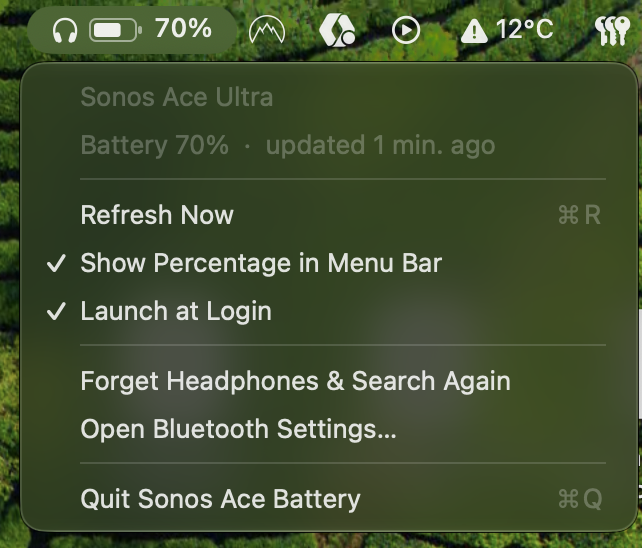
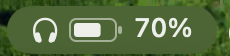

<div align="center">

# Sonos Ace Battery

**The battery level of your Sonos Ace headphones, right in the macOS menu bar.**

[](https://github.com/SleyAI/Sonos-Ace-Ultra-Battery-Indicator/releases/latest)


[](LICENSE)



</div>

macOS shows the battery of AirPods and many other Bluetooth headphones, but not of the
Sonos Ace and Sonos Ace Ultra. This tiny menu bar app fills that gap: a battery glyph
with the current percentage, updated live while the headphones are on.

## Features

- 🎧 **Live battery level** in the menu bar, with a glyph that fills proportionally
- 🔴 **Low battery warning**: the percentage turns red at 20 % and below
- 🔄 **Reconnects on its own** when the headphones come back into range
- 🚀 **Launch at login**, toggle from the menu
- 🪶 **Lightweight**: native Swift, no Dock icon, no background services, no Sonos account
- 🔒 **Private**: talks only to your headphones over Bluetooth, nothing leaves your Mac

## Installation

### Quick install (recommended)

Paste this into Terminal:

```bash
curl -fsSL https://raw.githubusercontent.com/SleyAI/Sonos-Ace-Ultra-Battery-Indicator/main/install.sh | bash
```

The script downloads the latest release, verifies its checksum, installs
**Sonos Ace Battery.app** into `/Applications` (or `~/Applications` if you aren't an
admin), registers it to launch at login, and starts it. Run the same command again any
time to update.

Options go after `bash -s --`, for example:

```bash
curl -fsSL https://raw.githubusercontent.com/SleyAI/Sonos-Ace-Ultra-Battery-Indicator/main/install.sh | bash -s -- --no-login-item
```

| Option | Effect |
| --- | --- |
| `--no-login-item` | Don't start the app automatically at login |
| `--version v1.0.0` | Install a specific release instead of the latest |
| `--from-source` | Build locally with the Swift toolchain instead of downloading |

### Manual download

1. Download **SonosAceBattery.dmg** from the [latest release](https://github.com/SleyAI/Sonos-Ace-Ultra-Battery-Indicator/releases/latest).
2. Open it and drag **Sonos Ace Battery** into **Applications**.
3. Open the app. Because it isn't notarized by Apple, macOS blocks the first launch:
   go to **System Settings › Privacy & Security**, scroll down and click
   **Open Anyway** next to the message about Sonos Ace Battery.

   Alternatively, clear the quarantine flag in Terminal:

   ```bash
   xattr -dr com.apple.quarantine "/Applications/Sonos Ace Battery.app"
   ```

### Build from source

Requires the Xcode command line tools (`xcode-select --install`, Swift 5.9+).

```bash
git clone https://github.com/SleyAI/Sonos-Ace-Ultra-Battery-Indicator.git
cd Sonos-Ace-Ultra-Battery-Indicator
./build.sh --install
```

### First launch

macOS asks once for **Bluetooth** access. Click **Allow**, otherwise the app can't see
your headphones. If you clicked *Don't Allow*, turn it on later in
**System Settings › Privacy & Security › Bluetooth**.

> [!NOTE]
> The app is ad-hoc signed, so macOS treats every new version as a new app and asks for
> Bluetooth access again after an update.

## Usage



Switch your headphones on and let them connect to your Mac. A few seconds later the icon
shows the battery percentage next to it. Click it for the details:

| Menu item | What it does |
| --- | --- |
| Device name and battery | Exact percentage and when it was last read |
| **Refresh Now** (⌘R) | Reads the battery level right away |
| **Show Percentage in Menu Bar** | Show or hide the number; the glyph always reflects the level |
| **Launch at Login** | Start the app automatically when you log in |
| **Forget Headphones & Search Again** | Drop the remembered headphones, e.g. after re-pairing or switching to another Sonos Ace |
| **Open Bluetooth Settings…** | Jump to the macOS Bluetooth settings |

A **dimmed icon with a question mark** means the headphones are off, out of range,
connected to another device instead of this Mac, or Bluetooth is disabled. The app keeps
waiting and reconnects automatically when they come back.

## How it works

The Sonos Ace reports its charge through the standard Bluetooth Low Energy
**Battery Service (0x180F)**, not through the classic hands-free battery indicator that
macOS reads for its Bluetooth menu. The LE battery service is right there and even pushes
change notifications, macOS just ignores it for audio devices.

This app opens its own LE connection to the headphones with CoreBluetooth, reads the
Battery Level characteristic (0x2A19), subscribes to notifications, and polls every two
minutes as a fallback. No private APIs, no kernel extensions, no Sonos account.

The app only opens that LE connection once the headphones' regular audio connection to
the Mac is up, and closes it when the audio connection drops. If the LE connection comes
first, macOS still plays audio through the headphones but leaves them out of the Sound
menu and Sound settings.

Tested with the Sonos Ace Ultra; the original Sonos Ace exposes the same service.

## Troubleshooting

**The icon stays dimmed / never connects**
- Make sure the headphones are connected to this Mac as an audio device. The app waits
  for that before it reads the battery.
- Check that Bluetooth access is allowed in **System Settings › Privacy & Security › Bluetooth**.
- Make sure the headphones aren't holding too many LE connections (for example several
  phones with the Sonos app open). Closing the Sonos app on other devices helps.
- Use **Forget Headphones & Search Again**.

**"Sonos Ace Battery can't be opened"** — see step 3 of the [manual download](#manual-download).

**Logs** — the app writes a short log you can attach to a bug report:

```bash
tail -f ~/Library/Logs/SonosAceBattery.log
```

It also logs to the unified log under the subsystem `com.buens.SonosAceBattery`.

## Uninstall

```bash
curl -fsSL https://raw.githubusercontent.com/SleyAI/Sonos-Ace-Ultra-Battery-Indicator/main/uninstall.sh | bash
```

This quits the app, removes its login item, the app itself, its settings, its log file
and the Bluetooth permission. Or just quit the app and drag it to the Trash.

## Development

```bash
./build.sh            # build into ./build
./build.sh --run      # build and launch from ./build
./build.sh --install  # build, copy to /Applications and launch
./build.sh --dist     # universal build, packaged as .zip and .dmg in ./dist
```

### Releasing

Push a version tag. The [Release workflow](.github/workflows/release.yml) builds a
universal binary, stamps the version into the bundle and publishes a GitHub release with
the `.zip` (used by `install.sh`), the `.dmg` and their SHA-256 checksums.

```bash
git tag v1.0.0
git push origin v1.0.0
```

### Project layout

```
Package.swift                         Swift Package (executable target)
Sources/SonosAceBattery/
  main.swift                          NSApplication bootstrap (accessory app, no Dock icon)
  AppDelegate.swift                   wires monitor and status item together
  BatteryMonitor.swift                CoreBluetooth: find, connect, read, notify, reconnect
  AudioLinkWatcher.swift              IOBluetooth: is the audio link to this Mac up?
  StatusItemController.swift          NSStatusItem, menu, launch-at-login
  BatteryIcon.swift                   template battery glyph with proportional fill
  Log.swift                           unified log, stderr and log file
Resources/Info.plist                  bundle metadata and Bluetooth usage description
build.sh                              builds, bundles and packages the .app
install.sh / uninstall.sh             one-line installer and uninstaller
.github/workflows/                    CI build and tagged releases
```

## License

[MIT](LICENSE)

Sonos and Sonos Ace are trademarks of Sonos, Inc. This project is not affiliated with or
endorsed by Sonos.
